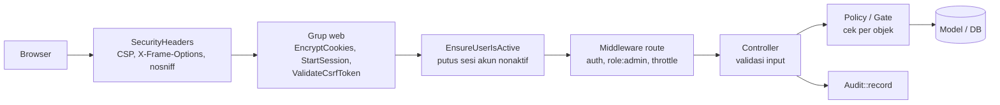
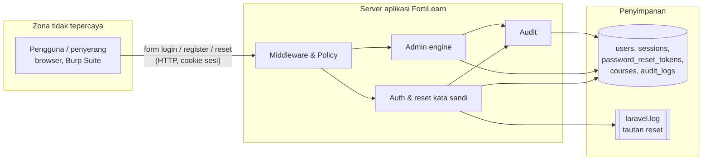
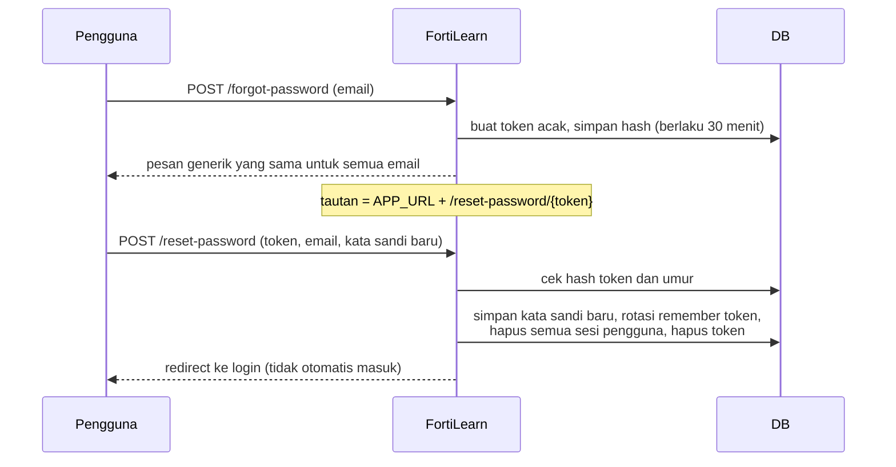
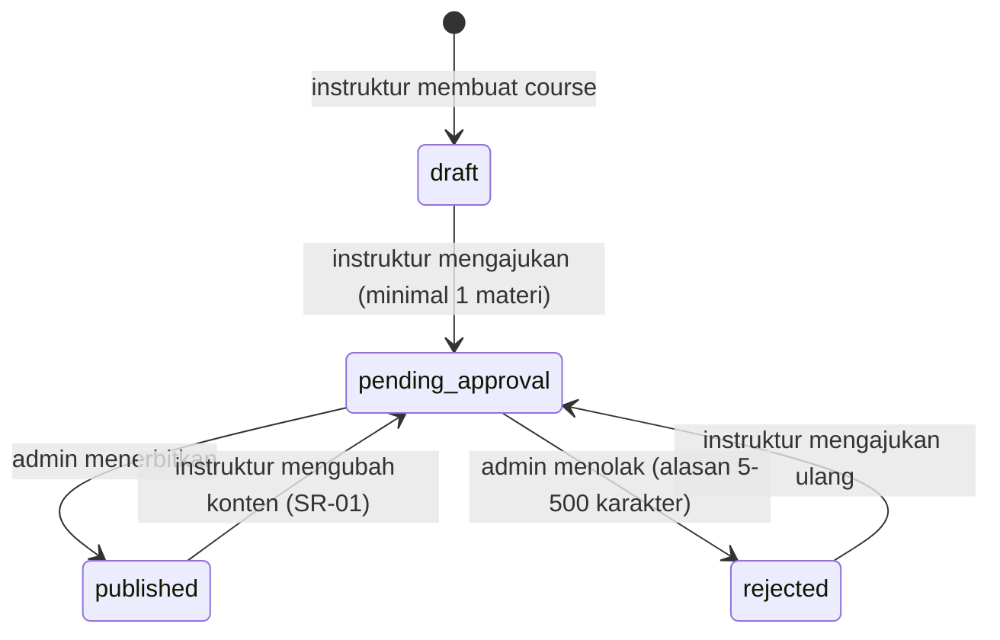

# Laporan Keamanan Perangkat Lunak: Jobdesk 1
## Security Lead, Auth & Admin Engine

> **Mata Kuliah:** COMP6695001 Secure Programming (AOL SOCS BINUS University)
> **Aplikasi:** FortiLearn (Secure E-Learning Web Application)
> **Cakupan bab:** Arsitektur Sistem, Threat Modeling, Sistem Autentikasi, Kontrol Akses Berbasis Peran (RBAC)
> **Versi kode:** branch `feature/auth-admin`, commit `6698bab`

---

## DAFTAR ISI
1. [Ringkasan & Ruang Lingkup](#1-ringkasan--ruang-lingkup)
2. [Arsitektur Sistem](#2-arsitektur-sistem)
3. [Threat Modeling](#3-threat-modeling)
4. [Sistem Autentikasi](#4-sistem-autentikasi)
5. [Kontrol Akses Berbasis Peran (RBAC) & Admin Engine](#5-kontrol-akses-berbasis-peran-rbac--admin-engine)
6. [Audit Trail](#6-audit-trail)
7. [Pembuktian Pengujian](#7-pembuktian-pengujian)
8. [Panduan Audit White-Box untuk Kelompok Penilai](#8-panduan-audit-white-box-untuk-kelompok-penilai)
9. [Keterbatasan yang Diketahui](#9-keterbatasan-yang-diketahui)

---

## 1. Ringkasan & Ruang Lingkup

Jobdesk 1 menyediakan fondasi yang dipakai semua modul lain: siapa pengguna yang sedang login, peran apa yang ia punya, dan jejak apa yang ditinggalkan setiap aksi sensitif.

| Komponen | File | Fungsi |
|---|---|---|
| Autentikasi | `app/Http/Controllers/Auth/AuthController.php` | Register, login, logout, lockout brute force |
| Lupa & reset kata sandi | `app/Http/Controllers/Auth/PasswordResetController.php` | Tautan reset, token sekali pakai, pemutusan sesi |
| Penjaga akun nonaktif | `app/Http/Middleware/EnsureUserIsActive.php` | Memutus sesi akun yang diblokir admin di semua route |
| RBAC | `app/Http/Middleware/RoleMiddleware.php`, `app/Policies/UserPolicy.php`, `CoursePolicy::moderate()` | Pembatasan per peran dan per objek |
| Admin engine | `app/Http/Controllers/Admin/*` | Ringkasan, kelola pengguna, moderasi course, audit log |
| Audit trail | `app/Support/Audit.php`, tabel `audit_logs` | Pencatatan event keamanan |
| Standar environment | `.env.example`, `config/auth.php` | Sesi terenkripsi, cookie HttpOnly, umur token reset |

Hasil self-review modul ini (metode, temuan SR-01, dan risiko sisa) ada di [`JOBDESK_1_SELF_REVIEW.md`](JOBDESK_1_SELF_REVIEW.md).

---

## 2. Arsitektur Sistem

### 2.1 Teknologi

| Lapisan | Teknologi | Catatan keamanan |
|---|---|---|
| Bahasa & framework | PHP 8.2+ (CI memakai 8.2), Laravel 12 | Eloquent ORM dengan parameter terikat, Blade auto-escaping, CSRF bawaan |
| Database | MySQL (XAMPP) untuk tim, SQLite untuk test dan CI | Skema lewat migration, tidak ada query string mentah dari input |
| Tampilan | Blade + Tailwind | Semua output memakai `{{ }}`; tidak ada `{!! !!}` di modul Jobdesk 1 |
| Penyimpanan file | Disk `local` privat (`storage/app/private`) | Tidak pernah di-symlink ke `public/` (Jobdesk 2) |
| Email | Driver `log` | Tautan reset ditulis ke `storage/logs/laravel.log`, cukup untuk lingkungan uji |
| CI | GitHub Actions `.github/workflows/security-tests.yml` | Menjalankan seluruh test pada setiap push ke `feature/*`, `develop`, `main` |

### 2.2 Alur request dan lapisan pertahanan

Setiap request melewati lapisan berikut secara berurutan. Jika satu lapisan menolak, lapisan berikutnya tidak pernah dijalankan.



| Lapisan | Lokasi | Yang dicegah |
|---|---|---|
| Security headers | `SecurityHeaders` (global, Jobdesk 4) | Clickjacking, MIME sniffing, sebagian XSS |
| Cookie terenkripsi & CSRF | Grup `web` Laravel | Pemalsuan cookie, Cross-Site Request Forgery |
| Akun aktif | `bootstrap/app.php:15`, `EnsureUserIsActive` | Akun yang diblokir tetap memakai sesi lama |
| Peran & throttle | `routes/web.php` (`role:admin`, `throttle:*`) | Akses lintas peran, brute force, spam form |
| Validasi | `$request->validate()` / Form Request | Input di luar format, mass assignment |
| Policy | `UserPolicy`, `CoursePolicy` | IDOR dan aksi pada objek yang bukan haknya |
| Audit | `Audit::record()` | Serangan yang tidak meninggalkan jejak |

### 2.3 Model data yang dikelola Jobdesk 1

| Tabel / kolom | Isi | Aturan keamanan |
|---|---|---|
| `users.password` | Hash bcrypt (cost 12) | Cast `hashed` di model; plaintext tidak pernah disimpan atau dicatat |
| `users.role` | `student`, `instructor`, `admin` | Tidak ada di `$fillable`; tidak bisa diisi dari request |
| `users.balance` | Saldo dompet | Tidak ada di `$fillable` (Jobdesk 3 mengelola lewat transaksi terkunci) |
| `users.is_active` | Status akun | Hanya diubah oleh admin lewat `UserPolicy` |
| `users.remember_token` | Token "ingat saya" | Dirotasi saat logout, reset kata sandi, dan penonaktifan |
| `sessions` | Sesi database, payload terenkripsi | Dihapus per pengguna saat reset atau penonaktifan |
| `password_reset_tokens` | Token reset ter-hash | Kedaluwarsa 30 menit, dihapus setelah dipakai |
| `audit_logs` | `event_type`, `user_id`, `ip_address`, `user_agent`, `payload` | Hanya dibaca admin; tidak pernah berisi kata sandi atau token |
| `courses.rejection_reason`, `reviewed_by`, `reviewed_at`, `approved_at` | Data moderasi | Tidak ada di `$fillable`; hanya ditulis oleh controller admin |

---

## 3. Threat Modeling

### 3.1 Diagram aliran data dan batas kepercayaan



Semua data yang melintasi batas dari zona tidak tepercaya ke server diperlakukan sebagai input berbahaya: email, kata sandi, token reset, parameter filter admin, alasan penolakan, header `Host`, dan cookie.

### 3.2 Analisis STRIDE

| # | Kategori | Ancaman | Dampak | Mitigasi | Bukti |
|---|---|---|---|---|---|
| T1 | Spoofing | Brute force kata sandi satu akun | Akun diambil alih | Lockout 5 gagal per (email, IP) selama 60 detik, dicek sebelum kata sandi | `AuthController.php:46`, AuthSecurityTest |
| T2 | Spoofing | Credential stuffing ke banyak email dari satu IP | Banyak akun diambil alih | Batas 20 request login per menit per IP | `routes/web.php:55` |
| T3 | Spoofing | Kata sandi lemah | Mudah ditebak | Minimal 8 karakter, huruf besar dan kecil, angka, simbol; maksimal 72 | `AppServiceProvider.php:38` |
| T4 | Spoofing | Session fixation | Penyerang memakai ID sesi yang ia tanam | `session()->regenerate()` saat login dan register | `AuthController.php:57`, `:115` |
| T5 | Spoofing | Pencurian cookie sesi | Sesi dibajak | Cookie HttpOnly, SameSite=lax, payload sesi terenkripsi, `Secure` saat HTTPS | `.env.example` |
| T6 | Spoofing | Password-reset poisoning lewat header `Host` | Tautan reset korban dikirim ke domain penyerang | Tautan dibangun dari `APP_URL` | `AppServiceProvider.php:42`, PasswordResetSecurityTest |
| T7 | Spoofing | Menebak atau memakai ulang token reset | Kata sandi korban diganti | Token acak 64 karakter disimpan ter-hash, berlaku 30 menit, sekali pakai, endpoint di-throttle | `config/auth.php:99` |
| T8 | Tampering | Mass assignment `role=admin` atau `balance` saat register | Eskalasi hak, saldo palsu | `$fillable` hanya `name`, `email`, `password` | `User.php:21`, SecurityArchitectureTest |
| T9 | Tampering | CSRF pada aksi admin (nonaktifkan user, terbitkan course) | Admin dipaksa melakukan aksi | Token CSRF di setiap form, aksi memakai PATCH | CsrfProtectionTest |
| T10 | Tampering | SQL injection di pencarian pengguna | Bocornya data atau bypass filter | Parameter terikat, wildcard `%` dan `_` di-escape dengan `ESCAPE '!'`; filter lain dibatasi `Rule::in` | `UserController.php:29` |
| T11 | Tampering | Instruktur mengubah course setelah disetujui | Konten tanpa review tampil di katalog | Course kembali ke antrean review; materi baru disembunyikan dari siswa sampai disetujui ulang | `Course.php:76`, CourseReModerationSecurityTest |
| T12 | Repudiation | Penyerang menyangkal percobaan login atau aksi admin | Tidak ada bukti forensik | Event auth dan admin dicatat di `audit_logs` beserta IP dan user agent | Bagian 6 |
| T13 | Info Disclosure | Enumerasi akun dari pesan login atau lupa kata sandi | Daftar email valid untuk serangan lanjutan | Pesan identik untuk email terdaftar dan tidak | PasswordResetSecurityTest |
| T14 | Info Disclosure | Kata sandi atau token masuk ke log | Kebocoran kredensial | Audit hanya menyimpan email dan hasil broker | AuthSecurityTest |
| T15 | Info Disclosure | XSS tersimpan lewat judul course atau alasan penolakan | Script berjalan di sesi admin | Semua output Blade di-escape | AdminModuleSecurityTest |
| T16 | Denial of Service | Penyerang sengaja mengunci akun korban | Korban tidak bisa login | Kunci per (email, IP), bukan per email saja | Keterbatasan RR-01 |
| T17 | Elevation | Student atau instruktur membuka halaman admin | Kontrol penuh aplikasi | `role:admin` di semua route `/admin/*`, Policy di setiap aksi tulis | `routes/web.php:87`, AdminModuleSecurityTest |
| T18 | Elevation | Admin (atau sesi admin yang dicuri) menonaktifkan admin lain | Tim tidak bisa merespons insiden | `UserPolicy::changeStatus` menolak target admin dan diri sendiri | `UserPolicy.php:14` |
| T19 | Elevation | Akun yang diblokir tetap memakai sesi lama | Pemblokiran tidak efektif | `EnsureUserIsActive` di grup web, sesi database dihapus, remember token dirotasi | `EnsureUserIsActive.php:22` |
| T20 | Elevation | Instruktur menerbitkan course sendiri | Lewat moderasi | Hanya `CoursePolicy::moderate` (admin aktif) yang mengubah status ke `published` | `CoursePolicy.php:49` |

---

## 4. Sistem Autentikasi

### 4.1 Registrasi

1. Input divalidasi: nama maksimal 255, email unik, kata sandi `confirmed`, `max:72`, dan `Password::defaults()`.
2. Model dibuat hanya dengan `name`, `email`, `password`. Field `role` dan `balance` dari request diabaikan karena tidak ada di `$fillable`; nilai default database (`student`, saldo 0) yang berlaku.
3. Kata sandi di-hash otomatis oleh cast `hashed` (bcrypt, `BCRYPT_ROUNDS=12`).
4. Pengguna langsung login, ID sesi diganti, event `auth.register` dicatat.
5. Endpoint dibatasi 5 request per menit per IP.

Batas 72 karakter ada karena bcrypt hanya membaca 72 byte pertama. Tanpa batas ini, dua kata sandi panjang yang berbeda di belakang bisa dianggap sama.

### 4.2 Login dan perlindungan brute force

```php
// app/Http/Controllers/Auth/AuthController.php
$throttleKey = $this->loginThrottleKey($request); // 'login:' . lower(email) . '|' . ip

if (RateLimiter::tooManyAttempts($throttleKey, self::MAX_LOGIN_ATTEMPTS)) {      // 5
    $seconds = RateLimiter::availableIn($throttleKey);
    Audit::record('auth.lockout', $request, ['email' => $credentials['email'], 'retry_after' => $seconds]);
    return back()->withErrors(['email' => "Terlalu banyak percobaan login. Coba lagi dalam {$seconds} detik."]);
}

if (Auth::attempt($credentials, $remember)) {
    $request->session()->regenerate();   // anti session fixation
    RateLimiter::clear($throttleKey);
    // akun nonaktif langsung di-logout dan dicatat sebagai auth.login_blocked_inactive
    ...
}

RateLimiter::hit($throttleKey, self::LOCKOUT_SECONDS);                           // 60 detik
Audit::record('auth.login_failed', $request, ['email' => $credentials['email']]);
```

Keputusan desain:

- **Kunci dicek sebelum kata sandi.** Saat terkunci, kata sandi yang benar pun ditolak. Penyerang tidak bisa memakai respons untuk tahu apakah tebakannya tepat.
- **Kunci per (email, IP), bukan per email saja.** Kunci per email memungkinkan siapa pun mengunci akun korban dengan sengaja. Serangan ke banyak email dari satu IP ditahan oleh batas kedua, 20 request per menit per IP.
- **Email dinormalisasi ke huruf kecil** sebelum menjadi kunci, sehingga `VICTIM@` dan `victim@` dihitung sama.
- **Pesan gagal selalu sama** untuk email yang tidak terdaftar dan kata sandi yang salah.

### 4.3 Manajemen sesi

| Pengaturan | Nilai | Alasan |
|---|---|---|
| `SESSION_DRIVER` | `database` | Sesi bisa dihapus per pengguna saat reset atau penonaktifan |
| `SESSION_ENCRYPT` | `true` | Isi sesi terenkripsi di database |
| `SESSION_HTTP_ONLY` | `true` | Cookie sesi tidak bisa dibaca JavaScript |
| `SESSION_SAME_SITE` | `lax` | Cookie tidak ikut pada POST lintas situs |
| `SESSION_SECURE_COOKIE` | `false` lokal, wajib `true` di HTTPS | Nilai `true` di `http://localhost` membuat login gagal karena cookie tidak dikirim |
| `SESSION_LIFETIME` | 120 menit | Batas umur sesi idle |

Logout memanggil `Auth::logout()`, `session()->invalidate()`, dan `session()->regenerateToken()`, sehingga sesi lama dan token CSRF lama tidak bisa dipakai lagi.

### 4.4 Lupa dan reset kata sandi



| Kontrol | Implementasi |
|---|---|
| Anti enumerasi | `PasswordResetController::GENERIC_SENT_STATUS` dipakai untuk semua email; hasil sebenarnya hanya di audit log |
| Anti reset-link poisoning | `ResetPassword::createUrlUsing()` membangun tautan dari `config('app.url')`, bukan dari header `Host` |
| Umur dan pemakaian token | `expire => 30` di `config/auth.php`; broker Laravel menghapus token setelah berhasil |
| Kebijakan kata sandi | Aturan yang sama dengan registrasi (`Password::defaults()`, `max:72`) |
| Pemutusan sesi | `setRememberToken(Str::random(60))` dan penghapusan baris `sessions` milik pengguna |
| Rate limit | 5 request per menit per IP untuk kedua endpoint |

### 4.5 Akun nonaktif

Pemblokiran harus berlaku seketika. Tiga mekanisme bekerja bersama:

1. Saat admin menonaktifkan akun, remember token dirotasi dan semua baris `sessions` pengguna dihapus.
2. `EnsureUserIsActive` dipasang di grup `web` (`bootstrap/app.php:15`), jadi berlaku di **semua** route, termasuk route yang hanya memakai `auth` seperti dompet dan checkout. Sebelum Jobdesk 1, pengecekan `is_active` hanya ada di `RoleMiddleware`, sehingga student yang diblokir masih bisa memakai dompet sampai sesinya habis.
3. Login akun nonaktif ditolak setelah kredensial dicek, dan dicatat sebagai `auth.login_blocked_inactive`.

---

## 5. Kontrol Akses Berbasis Peran (RBAC) & Admin Engine

### 5.1 Peran dan hak akses

| Fitur | Tamu | Student | Instruktur | Admin |
|---|---|---|---|---|
| Katalog course terbit | Ya | Ya | Ya | Ya |
| Dompet, checkout, invoice | Tidak | Ya (milik sendiri) | Ya (milik sendiri) | Ya (milik sendiri) |
| Studio instruktur | Tidak | Tidak | Ya (course sendiri) | Tidak |
| Ringkasan admin, kelola pengguna, moderasi, audit log | Tidak | Tidak | Tidak | Ya |
| Menonaktifkan akun | Tidak | Tidak | Tidak | Ya, kecuali diri sendiri dan admin lain |
| Menerbitkan atau menolak course | Tidak | Tidak | Tidak | Ya |

### 5.2 Dua lapis pemeriksaan

**Lapis 1, peran (route):** semua route `/admin/*` berada dalam satu grup `['auth', 'role:admin']` (`routes/web.php:87`). `RoleMiddleware` membandingkan peran dengan `in_array(..., true)` (perbandingan ketat), menolak dengan 403, dan mencatat `access.role_denied`.

**Lapis 2, objek (Policy):** setiap aksi tulis memanggil Policy lagi di controller, jadi kesalahan konfigurasi route di masa depan tidak langsung membuka celah.

```php
// app/Policies/UserPolicy.php
public function changeStatus(User $actor, User $target): bool
{
    return $actor->isAdmin()
        && $actor->is_active
        && $actor->id !== $target->id   // admin tidak bisa mengunci dirinya sendiri
        && ! $target->isAdmin();        // sesi admin yang dicuri tidak bisa melumpuhkan admin lain
}

// app/Policies/CoursePolicy.php
public function moderate(User $user): bool
{
    return $user->isAdmin() && $user->is_active;
}
```

Peran pengguna sengaja **tidak bisa diubah** dari aplikasi. Tidak ada endpoint ganti peran, jadi tidak ada permukaan serangan eskalasi hak dari antarmuka admin.

### 5.3 Moderasi course



Perubahan status oleh admin dijalankan sebagai satu pernyataan SQL bersyarat:

```php
// app/Http/Controllers/Admin/CourseModerationController.php
$updated = Course::whereKey($course->id)
    ->where('status', 'pending_approval')   // cek dan tulis dalam satu UPDATE atomik
    ->update(['status' => $to, 'rejection_reason' => $reason,
              'reviewed_by' => $request->user()->id, 'reviewed_at' => now()] + $extra);

if ($updated === 0) {
    return back()->with('error', 'Course ini tidak sedang menunggu review, jadi tidak bisa diproses.');
}
```

Karena pengecekan dan penulisan terjadi dalam satu pernyataan, dua admin yang menekan tombol bersamaan (atau klik ganda) tidak bisa memproses course yang sama dua kali.

**Review ulang setelah terbit.** Self-review menemukan bahwa course yang sudah disetujui masih bisa diubah instruktur tanpa review (SR-01). Sekarang setiap perubahan konten pada course `published` mengembalikannya ke `pending_approval`. Siswa yang sudah membayar tetap bisa membuka materi yang pernah disetujui, tetapi materi yang ditambahkan setelah `approved_at` disembunyikan sampai admin menyetujui ulang. Detail lengkap di [`JOBDESK_1_SELF_REVIEW.md`](JOBDESK_1_SELF_REVIEW.md).

### 5.4 Keamanan halaman admin

| Halaman | Input | Kontrol |
|---|---|---|
| Kelola pengguna | `q`, `role`, `state` | `q` maksimal 100 karakter, dicari dengan parameter terikat dan wildcard di-escape; `role` dan `state` dibatasi `Rule::in` |
| Moderasi course | `status`, `reason` | `status` dibatasi `Rule::in`; `reason` wajib 5-500 karakter dan selalu dicetak dengan `{{ }}` |
| Audit log | `event`, `security` | `event` hanya menerima jenis event yang benar-benar ada di tabel; `security` boolean |
| Semua aksi tulis | Form PATCH | Token CSRF, Policy, audit; GET ke URL aksi ditolak 405 |

---

## 6. Audit Trail

`Audit::record()` menulis satu baris ke `audit_logs` berisi jenis event, pelaku, IP, user agent (maksimal 500 karakter), dan payload JSON. Parameter `$userId` opsional dipakai untuk event yang terjadi sebelum pengguna login, misalnya reset kata sandi.

| Event | Kapan | Payload |
|---|---|---|
| `auth.login_success` | Login berhasil | (kosong) |
| `auth.login_failed` | Kredensial salah | email yang diketik |
| `auth.lockout` | Percobaan saat terkunci | email, sisa detik |
| `auth.login_blocked_inactive` | Login akun nonaktif | (kosong) |
| `auth.inactive_session_terminated` | Sesi akun nonaktif diputus | path |
| `auth.logout`, `auth.register` | Logout, registrasi | (kosong) |
| `auth.password_reset_requested` / `_completed` / `_failed` | Alur reset | email, hasil broker |
| `access.role_denied` | 403 karena peran | path, peran, peran yang dibutuhkan |
| `admin.user_deactivated` / `admin.user_activated` | Aksi admin | id dan email target |
| `admin.course_approved` / `admin.course_rejected` | Moderasi | id course, judul, alasan |
| `course.resubmitted_after_edit` | Course terbit diubah instruktur | id course, jenis perubahan |

Kata sandi dan token reset tidak pernah masuk payload. Halaman Audit Log hanya bisa dibaca admin dan tidak menyediakan aksi ubah atau hapus.

---

## 7. Pembuktian Pengujian

Seluruh test dijalankan dengan `php artisan test`. Hasil pada commit `6698bab`: **124 passed (493 assertions)**, stabil pada tiga kali eksekusi berturut-turut dan pada clone bersih yang meniru langkah CI.

| File test | Jumlah | Ancaman yang dibuktikan tertutup |
|---|---|---|
| `AuthSecurityTest` | 15 | T1-T5, T8, T14, T19 |
| `PasswordResetSecurityTest` | 12 | T6, T7, T13 |
| `AdminModuleSecurityTest` | 20 | T10, T15, T17, T18, T20 |
| `CsrfProtectionTest` | 4 | T9 |
| `CourseReModerationSecurityTest` | 13 | T11 |

Catatan metode:

- **Test ditulis sebelum kode** (TDD). Setiap file test gagal semua terlebih dulu, baru kemudian implementasi dibuat sampai lulus.
- **CSRF diuji dengan pemeriksaan aktif.** Laravel mematikan verifikasi CSRF saat test berjalan, sehingga `CsrfProtectionTest` menyalakannya kembali. Untuk memastikan test ini benar-benar mendeteksi masalah, CSRF dimatikan sementara (`validateCsrfTokens(except: ['*'])`): tiga dari empat test langsung gagal, lalu konfigurasi dikembalikan.
- **Uji langsung di server lokal** oleh pengembang: lockout setelah enam login salah, reset kata sandi dengan header `Host` palsu (tautan tetap berawalan `APP_URL`), alur tinjau dan tolak course oleh admin, penonaktifan akun, dan tampilan halaman admin pada lebar 375 px. Panduan uji manual lengkap untuk anggota tim ada di `testing-guide.docx` (50 langkah dalam 10 grup).

---

## 8. Panduan Audit White-Box untuk Kelompok Penilai

| Yang ingin diuji | Di mana melihat | Cara menguji |
|---|---|---|
| Brute force login | `AuthController::login()` | Kirim 6 login salah untuk satu email; percobaan ke-6 dengan kata sandi benar tetap ditolak |
| Eskalasi peran saat register | `User::$fillable`, `AuthController::register()` | Tambahkan `role=admin&balance=9999999` di body POST `/register` dengan Burp |
| Reset-link poisoning | `AppServiceProvider::boot()` | Kirim POST `/forgot-password` dengan header `Host: evil.test`, lalu lihat tautan di log |
| Enumerasi akun | `PasswordResetController::sendResetLink()` | Bandingkan respons untuk email terdaftar dan tidak terdaftar |
| Akses admin oleh non-admin | `routes/web.php` grup `admin.`, `RoleMiddleware` | Login sebagai student, buka setiap URL `/admin/*` dan kirim PATCH ke aksi admin |
| Menonaktifkan admin lain | `UserPolicy::changeStatus()` | Sebagai admin, kirim PATCH `/admin/users/{id_admin_lain}/deactivate` |
| SQL injection di pencarian | `Admin\UserController::index()` | Isi `q` dengan `%' OR 1=1 --` atau `%` |
| Race condition moderasi | `CourseModerationController::transition()` | Kirim approve dan reject bersamaan untuk course yang sama |
| Bypass moderasi | `Course::flagForReReview()` | Ubah course yang sudah terbit sebagai instruktur, lalu cek katalog |
| Sesi akun yang diblokir | `EnsureUserIsActive` | Nonaktifkan akun yang sedang login, lalu buka `/wallet` dari sesi itu |

---

## 9. Keterbatasan yang Diketahui

| ID | Keterbatasan | Alasan / rencana |
|---|---|---|
| RR-01 | Lockout per (email, IP) tidak menahan brute force terdistribusi dari banyak IP ke satu akun | Lockout per email membuka account-lockout DoS. Langkah lanjutan: CAPTCHA atau MFA setelah beberapa kegagalan |
| RR-02 | Enumerasi akun lewat perbedaan waktu respons | Isi respons sudah identik. Perbaikan penuh butuh hash palsu saat email tidak ada dan pengiriman email lewat queue |
| RR-03 | CSP masih `script-src 'unsafe-inline'` (Jobdesk 4) | Direkomendasikan memindahkan skrip inline ke file atau memakai nonce |
| RR-04 | `status` masih ada di `Course::$fillable` (Jobdesk 2) | Aman selama `CourseRequest` tidak menerima `status`; direkomendasikan dihapus dari `$fillable` |
| RR-05 | Siswa lama melihat judul dan deskripsi baru selama course menunggu review ulang | Hanya metadata teks; materi baru tetap tersembunyi |
| RR-06 | Tidak ada verifikasi email dan MFA | Di luar cakupan tugas; `MustVerifyEmail` dan TOTP adalah langkah berikutnya |
| RR-07 | Belum diuji pada MySQL secara otomatis | CI dan test memakai SQLite. Query pencarian memakai `ESCAPE '!'` yang didukung keduanya |

### Tangkapan layar yang perlu ditambahkan ke Application Report

Laporan ini memuat potongan kode. Tangkapan layar berikut diambil dari aplikasi yang berjalan saat menyusun laporan akhir:

1. Halaman login dengan pesan lockout ("Terlalu banyak percobaan login").
2. Halaman lupa kata sandi dengan pesan generik, dan baris tautan reset di `laravel.log` yang berawalan `APP_URL` walau request memakai `Host` palsu.
3. Halaman 403 saat student membuka `/admin/dashboard`.
4. Ringkasan Admin dengan antrean review dan event keamanan.
5. Kelola Pengguna setelah menonaktifkan akun, dan halaman login akun tersebut.
6. Halaman review course dengan label "Baru sejak terakhir disetujui".
7. Audit Log dengan filter "Hanya event keamanan".
8. Output `php artisan test` (124 passed).
